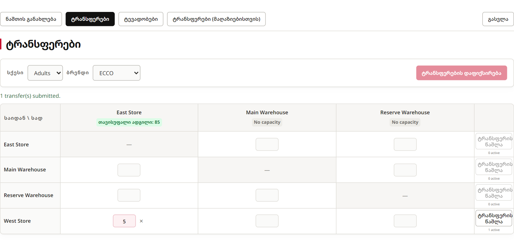

# Store Transfer Capacity Visibility Tool

[](https://github.com/MishaGeg/store-transfer-capacity-tool/actions/workflows/tests.yml)

How many more pairs of shoes can a store receive? Several brands share floor space, and recent inbound plans already reserve some of it. This Flask application combines stock from Excel with those plans and shows the remaining capacity as a supply chain specialist plans a transfer. Store managers can sign in to see what is coming. The CRM records the actual stock movement.



The **5** in the West Store row is the saved plan. The green **85** above the East Store column is the space left at the destination. The screenshot uses fictional location labels and the sample workbook's stock quantities.

[Try the sample](#try-it-with-sample-stock) · [Run locally](docs/setup.md) · [Business rules](#business-rules) · [API reference](#api-reference) · [Tests](#testing)

## Architecture

In Docker Compose, Caddy listens on local port 8080 and forwards requests to Gunicorn, which serves Flask. Flask renders Jinja pages, serves the React planner's API, and reads and writes inventory data in PostgreSQL through SQLAlchemy. Redis holds login rate-limit counters. The web app uses a restricted database role. A separate migration service uses the owner role to change the schema. [Compose configuration](compose.yaml) · [Backup and restore](docs/backup-and-restore.md)

## Try it with sample stock

Watch a transfer from West Store reserve space for five pairs at East Store. The animation uses the same fictional location labels as the screenshot. [Watch the 9-second planner demo](docs/transfer-planner-demo.gif)

Start with a fresh, disposable database and the [local setup guide](docs/setup.md). The [sample workbook](samples/stock_sample.xlsx) contains six rows for three locations. Its quantities are synthetic. Importing it replaces matching quantities in the active database.

1. **Import.** Sign in as a supply chain user, open the stock import page, and upload the workbook. The result should show **6 accepted rows**.
2. **Set capacity.** In the workbook, find the retail store with **10** pairs of adult ECCO footwear (location in column E). On the capacities page, set that store's `ECCOGEOXSTUDIO` group to **100**. Select **Adults** and **ECCO** on the planner. The destination now shows **90** free.
3. **Plan a transfer.** Find the source store with **40** pairs of adult ECCO footwear. Enter **5** where its row meets the destination column and submit. The saved cell locks and the destination now shows **85** free.
4. **View the plan.** Sign in with a store-manager account and open the read-only transfers page (`/public-transfers`). The incoming plan shows the same source, destination, and quantity.

## Using the Application

| Page | Path | Access |
| --- | --- | --- |
| Login | `/login` | Public |
| Plan transfers | `/transfers-page` | Supply chain |
| Import stock | `/import-stock` | Supply chain |
| Edit capacities | `/edit-capacities` | Supply chain |
| View planned transfers | `/public-transfers` | Both roles, login required, read-only |

Saved transfer cells are locked. To change a saved transfer, delete it and
submit a replacement. Drag store headers or row labels to reorder the grid;
the order is saved in the browser's local storage.

The viewing page can filter incoming transfers by destination store. Both
the page and its API require login. The viewing page and the management grid
show transfers submitted within the last five days.
The legacy route name `/public-transfers` refers to the view shared by both signed-in roles.
The filter is a display convenience, not a restriction to one manager's store.
Supply-chain users see management navigation; store managers see viewing and logout only.

## Business Rules

The API and database use `segment` for the age group: `ADULTS` or `KIDS`.

### Available space

```text
Available space = configured group capacity
                  - current group FOOTWEAR stock
                  - group inbound planned quantities submitted in the last five days
```

Slippers do not count toward capacity. Outbound plans are not subtracted from
current stock. At five days, plans stop reserving space and disappear from both
transfer lists. Their records remain in the database. Negative available space
indicates a shortfall.

### Shared capacity groups

The current catalog assigns the following brand/age-group pairs to shared
capacity groups at each location:

| Capacity group | Brand / age-group pairs |
| --- | --- |
| `ECCOGEOXSTUDIO` | ECCO/ADULTS, GEOX/ADULTS, STUDIO/ADULTS, REPLAY/ADULTS |
| `BATABAMBINO` | BATA/ADULTS, BAMB/KIDS, ECCO/KIDS, GEOX/KIDS |
| `SCARPIERA` | SCARPIERA/ADULTS |

These assignments are defined in `BRAND_AGE_GROUP` in [catalog.py](catalog.py).
They can be added, removed, or reassigned as business requirements change;
the table above reflects the current configuration.

Stock and transfers contain individual brand names. Capacity records contain
group labels. For example, ECCO Adults and ECCO Kids use different groups.

### Transfer eligibility

Retail sources require positive FOOTWEAR stock for the exact selected brand
and age group. Retail destinations require positive configured capacity for
that pair's group; zero or unset capacity hides the destination column. Warehouses always appear
as sources and destinations. A warehouse without configured capacity has
unknown available space (`null`), rather than zero.

Capacity warnings are advisory. A supply chain specialist can still submit a plan when space is low.

## Excel Stock Imports

Upload an `.xlsx` workbook on `/import-stock`. The importer reads the active worksheet and uses the first row as a header. The request-size limit is 5 MiB, including upload overhead.

| Workbook columns | How the importer uses them |
| --- | --- |
| A (category), F (age group) | Includes adult footwear and slippers, and kids' footwear. Rows outside those combinations are filtered out before validation and do not appear in either result count. |
| D (brand), E (location), G (quantity) | For rows within scope, a missing brand, unknown location, or missing or unconvertible quantity produces a skipped-row reason with its row number. |

Accepted rows with the same location, brand, category, and age group are summed. The total replaces the matching stock quantity. Existing records omitted from the workbook keep their previous quantities.

## Design Decisions

- **Advisory capacity:** supply chain specialists retain the final decision
  about a plan. The tool provides capacity guidance; actual transfers happen in CRM.
- **Shared capacity groups:** the grouped brand/age-group combinations occupy
  the same physical store space, so their stock consumes one shared capacity.
- **Partial-success submissions:** valid rows can be saved while rejected rows
  are returned for correction. Clients must inspect both `created` and `errors`.

CRM is the system of record for transaction history; this tool maintains
working plans, so deleting a plan removes it permanently without an audit trail.
There is no update endpoint: changing a saved transfer means deleting it and
submitting a replacement. After five days, plans disappear from both lists and
remain in the database until explicitly deleted.

## Project Structure

| Component | Responsibility |
| --- | --- |
| `app.py` | Configuration, extensions, blueprint registration, and shared error handlers |
| `models.py` | Database models and constraints |
| `catalog.py` | Brand/age-group mappings and shared capacity groups |
| `transfers.py` | Transfer APIs, grid options, and available-space calculation |
| `capacities.py` | Capacity listing and updates |
| `stock_snapshot.py` | Excel loading, validation, aggregation, and stock persistence |
| `stores.py` / `user.py` | Store listing, session authentication, and account CLI commands |
| `permissions.py` | Supply-chain route permission checks |
| `seed.py` | Location seeding |
| `templates/` | Jinja pages with inline styles and JavaScript |
| `migrations/` | Alembic database schema history |
| `tests/` | pytest tests and database fixtures |

## API Reference

For an API client, first request `GET /login`, keep the session cookie, and read
the token from the page's `<meta name="csrf-token">` element. Send the token in
`X-CSRFToken` on every POST, PUT, and DELETE, including login, logout, and Excel
uploads. Keep the session cookie updated from responses. The web pages handle
this automatically. Send credentials and other JSON payloads as JSON and
upload workbooks as multipart form data.

Login is limited to ten requests per minute per client IP and returns HTTP 429
when the limit is exceeded. A successful login returns a role-specific
`next_page`. Sessions expire after one hour of inactivity. Both roles can read
`/view-transfers`. Management endpoints require `supply_chain` and return
HTTP 403 for a signed-in store manager.

| Method | Endpoint | Purpose |
| --- | --- | --- |
| GET | `/ready` | Public readiness check. Returns 200 when the app can read `users` and reach rate-limit storage, or 503 if either check fails. |
| POST | `/login` | Sign in with `username` and `password` |
| POST | `/logout` | End the login session |
| GET | `/stores` | List stores and warehouses |
| GET | `/transfer-options?brand=ECCO&segment=ADULTS` | Get eligible locations and destination free space |
| GET | `/transfers` | List planned transfers from the last five days |
| POST | `/transfers` | Submit a batch of planned transfers |
| DELETE | `/transfers/<id>` | Permanently delete a planned transfer |
| GET | `/view-transfers` | View transfers from the last five days with source and destination names |
| GET | `/capacities` | List shared capacities by location |
| PUT | `/capacities/<store_id>/<brand>` | Set a capacity with `{"capacity": 125}`; `brand` is a group label |
| POST | `/import-stock` | Upload an `.xlsx` file in form field `file` |
| GET | `/current-stock` | List stored stock quantities |
| GET | `/last-stock-update` | Get the newest stock timestamp |

Transfer submission expects `{"transfers": [...]}`. Each row needs `brand`,
`segment`, `quantity`, `from_store_id`, and `to_store_id`. For a list of rows,
the response contains `created` and `errors`. HTTP 201 means full success,
207 means partial success, and 400 means no rows were accepted. An invalid
batch structure returns HTTP 400 with a single `error` field. Row-error indexes start
at zero. Transfers require a valid catalog pair, a whole-number quantity from
1 through 2,147,483,647, and two different existing stores with integer IDs.
Capacity values must be integers from 0 through 2,147,483,647.

## Testing

The PostgreSQL suite passed 243 tests at [`07116ba`](https://github.com/MishaGeg/store-transfer-capacity-tool/commit/07116ba34bd0468d53ea59484c440d7c56310228). The sample integration test covers the workbook import, the change from 90 to 85 free spaces, and the manager's view of the saved plan. The GitHub Actions workflow upgrades an empty database to the latest migration before running pytest against a separate database. [Testing guide](docs/testing.md)

## Current Limitations

- If `/stores` or `/transfers` returns a successful response containing a JSON
  value other than an array, the planner treats it as an empty list.
- Unsaved drafts are separate for each brand and age group. Reloading the
  planner discards them.
- The planner filters eligible sources and destinations by stock and configured
  capacity. The transfer submission API validates the submitted rows without
  applying those grid filters.
- Transfer timestamps use server-local time (Asia/Tbilisi in Docker). The API
  sends them without a timezone offset.
- The transfer grid uses React and ReactDOM. Babel compiles its JSX in the browser. All three scripts are version-pinned on unpkg and have integrity hashes. Loading the grid depends on the CDN. [Planner template](templates/transfers.html)
- The UI mixes Georgian and English, including the `Adults` and `Kids` labels.
- Deleting a plan permanently removes it from the app without an audit record.
